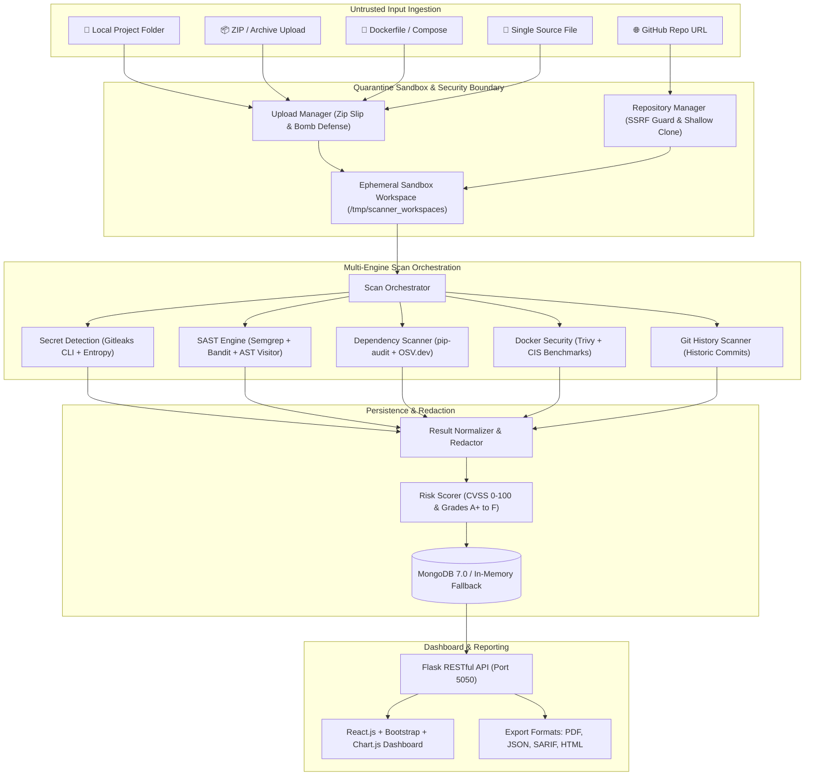

# 🛡️ Secret Leak Guard — Universal Source Code Security Scanner & Pipeline Defense

> **Enterprise-Grade DevSecOps Project:** A centralized multi-engine security scanning platform and automated CI/CD pipeline defense. Scans external codebases, ZIP archives, GitHub repositories, Dockerfiles, and Git history for leaked secrets, SAST vulnerabilities, vulnerable dependencies, and container risks.

[](https://python.org)
[](https://www.mongodb.com/)
[](https://nginx.org)
[](https://react.dev/)
[](https://github.com/gitleaks/gitleaks)
[](https://github.com/aquasecurity/trivy)
[](https://pre-commit.com/)
[](LICENSE)

---

## 🌟 Universal Scanner Overview (v2.0 Architecture)

The **Universal Source Code Security Scanner** expands Secret Leak Guard into a complete web-based DevSecOps platform capable of analyzing arbitrary untrusted repositories, archives, and containers without executing code.



---

## 🌐 Unified Nginx Edge Gateway (Single Entry Point)

To prevent port clutter and provide a secure, centralized API Gateway, all microservices and interfaces are unified under **one single URL** using an enterprise Nginx 1.27 reverse proxy:

```mermaid
flowchart LR
    Client(["👤 Web Browser / CI-CD / CLI"]) -->|http://localhost/| NGINX["🛡️ Nginx Edge Gateway (Port 80 / 8080)"]

    subgraph Backends["Unified Microservices Cluster"]
        NGINX -->|"/" & "/api/v1/"| SCANNER["Universal Scanner & React UI (Port 5050)"]
        NGINX -->|"/app/"| APP["Runtime Secured Demo App (Port 5000)"]
        NGINX -->|"/vault/"| VAULT["HashiCorp Vault UI & API (Port 8200)"]
        NGINX -->|"/nginx-health"| HEALTH["Gateway Health & Route Diagnostics"]
    end
```

### Unified URL Mapping Table

| Public Gateway URL | Upstream Target | Purpose / Capability |
|:---|:---|:---|
| **`http://localhost/`** | `scanner-api:5050/` | **DevSecOps Portal & React 18 UI:** Live scanning, charts, reports |
| **`http://localhost/api/v1/...`** | `scanner-api:5050/api/v1/...` | **Scanner REST API:** Ingest local, ZIP, GitHub, and Docker sources |
| **`http://localhost/api/v1/scans/:id/report/html`** | `scanner-api:5050/...` | **HTML & Vector PDF Audit Reports:** Downloadable compliance exports |
| **`http://localhost/app/`** | `app:5000/` | **Secured App Web Interface:** 12-factor secret posture demonstration |
| **`http://localhost/app/health`** | `app:5000/health` | **App Health Endpoint:** Verifies in-memory secret provisioning |
| **`http://localhost/app/api/secrets/status`** | `app:5000/api/secrets/status` | **Masked Secret Telemetry:** Diagnostics without leaking credentials |
| **`http://localhost/vault/`** | `vault:8200/` | **HashiCorp Vault:** Interactive Vault Secrets Engine console |
| **`http://localhost/nginx-health`** | Nginx Direct (200 OK) | **Gateway Diagnostics:** JSON health verification and route registry |

### Gateway Hardening & Security Features
- **Zero Request Size Truncation:** Configured with `client_max_body_size 100M;` to support large source-code ZIP archives and multi-gigabyte repositories.
- **Deep Scan Timeout Protection:** `proxy_read_timeout 300s;` and disabled response buffering ensures long-running SAST, OSV, and Git history scans stream without timeouts.
- **Enterprise Security Headers:** Emits `X-Frame-Options SAMEORIGIN`, `X-Content-Type-Options nosniff`, `X-XSS-Protection 1; mode=block`, and `Referrer-Policy strict-origin-when-cross-origin`.
- **Automatic Trailing Slash Normalization:** Redirects `/app` $\rightarrow$ `/app/` and `/vault` $\rightarrow$ `/vault/` with HTTP 301.
- **Native Host Gateway Option:** A lightweight Python gateway (`scripts/run_gateway.py`) is also included for zero-Docker local workstation development.

---

### Key Security Modules

1. **A. Secret Detection Engine (`Gitleaks` + Shannon Entropy + Regex)**
   - Flags AWS keys, GitHub tokens, database passwords, unencrypted private keys, JWT secrets, and Slack/Discord webhooks.
   - Shannon entropy detector flags high-entropy tokens (> 4.5 bits/char).
   - Zero-leak guarantee: all secrets are strictly masked (`AKIA****************`) in evidence, reports, and logs.

2. **B. SAST Vulnerability Detection Engine (`Semgrep` + `Bandit` + Python AST)**
   - Detects SQL injection, command injection (`shell=True`), Cross-Site Scripting (XSS), path traversal, insecure deserialization (`pickle.loads`), weak cryptography (MD5/SHA1), and unsafe file uploads.
   - Maps each finding to standard CWE and OWASP Top 10 categories.

3. **C. Dependency Vulnerability Scanner (`pip-audit` + `OSV-Scanner` + `OSV.dev`)**
   - Parses `requirements.txt`, `package.json`, `pom.xml`, `go.mod`, and `Gemfile`.
   - Cross-references package versions against Google's OSV database and local vulnerability definitions for CVE reporting.

4. **D. Docker & Container Security Scanner (`Trivy` + CIS Rules)**
   - Scans `Dockerfile` and `docker-compose.yml` for non-root execution (`USER root`), hardcoded `ENV` secrets, copying `.env` files, dangerous exposed ports (`EXPOSE 22`, `EXPOSE 2375`), and privileged mounts (`/var/run/docker.sock`).

5. **E. Git History Scanner (`Gitleaks` History + Git Log Diff)**
   - Inspects full commit history to uncover secrets introduced in older commits or removed from the working tree.

---

## 🏗️ Repository Layout

```text
Cdd--Project/
├── Dockerfile                      # Hardened Multi-Stage Dockerfile (non-root UID 10001)
├── Dockerfile.scanner              # Hardened Security Scanner Engine Container
├── Dockerfile.nginx                # Hardened Nginx 1.27 Edge Gateway Container
├── docker-compose.yml              # Full Multi-Container DevSecOps Orchestration (Port 80/8080)
├── .gitleaks.toml                  # Custom Gitleaks configuration with college rules
├── .gitleaksignore                 # Baseline allowlist for approved mock test fixtures
├── .pre-commit-config.yaml         # Pre-commit hook configuration
├── README.md                       # Complete DevSecOps Architecture & Runbook
│
├── nginx/                          # Nginx Gateway Reverse Proxy Configuration
│   ├── nginx.conf                  # Core Nginx performance & buffer quotas (100MB body)
│   ├── conf.d/default.conf         # Unified route mappings (/, /app/, /vault/, /nginx-health)
│   └── local-nginx.conf            # Native host configuration for workstation testing
│
├── scanner/                        # Universal Security Scanner Package
│   ├── config.py                   # Global limits, environment configurations
│   ├── db.py                       # MongoDB persistence with transparent in-memory fallback
│   ├── models.py                   # Finding, ScanRecord, and ScanRequest data structures
│   ├── orchestrator.py             # Multi-engine scan dispatcher & quarantine manager
│   ├── ingestion/
│   │   ├── upload_manager.py       # Safe archive decompression with Zip Slip defense
│   │   └── repository_manager.py   # SSRF-protected shallow Git cloning
│   ├── engines/
│   │   ├── secret_engine.py        # Gitleaks + Shannon entropy detector
│   │   ├── sast_engine.py          # Semgrep/Bandit + AST static analysis
│   │   ├── dependency_engine.py    # pip-audit / OSV manifest CVE scanner
│   │   ├── docker_engine.py        # Trivy + CIS container configuration auditor
│   │   └── git_history_engine.py   # Deep historical commit secret inspector
│   ├── processing/
│   │   ├── redactor.py             # Zero-leak regex secret masker
│   │   ├── normalizer.py           # Deduplication with SHA-256 finding fingerprints
│   │   └── risk_scorer.py          # CVSS-weighted scoring (0-100) & letter grades (A+ to F)
│   ├── reporting/
│   │   ├── pdf_generator.py        # Vector PDF audit report generator (ReportLab)
│   │   ├── json_generator.py       # Normalized JSON and OASIS SARIF v2.1.0 exporter
│   │   └── html_generator.py       # Standalone interactive HTML report with Chart.js
│   └── api/
│       ├── app.py                  # Flask Application factory with security headers
│       ├── auth.py                 # JWT authentication & RBAC (Admin, Analyst, Viewer)
│       └── routes/                 # Blueprints for scans, reports, dashboard metrics
│
├── frontend/                       # React 18 DevSecOps Dashboard
│   ├── build/index.html            # Compiled single-file production SPA with Unified Gateway Switcher
│   ├── src/                        # React source components (Navbar, MetricCards, ScanModal)
│   └── package.json
│
├── app/                            # Runtime Protected Demo Application
│   ├── main.py                     # Flask application with RedactingFormatter
│   ├── config.py                   # 12-factor configuration (Env & Vault)
│   ├── vault_client.py             # HashiCorp Vault client with safe fallback
│   └── rotation_monitor.py         # Background secret expiration monitor
│
├── bad-example/                    # Insecure demonstration fixtures (blocked by pipeline)
├── good-example/                   # Hardened demonstration fixtures (passes pipeline)
├── scripts/
│   ├── run_scanner.py              # CLI & Web server entrypoint
│   ├── run_gateway.py              # Pure Python local unified gateway runner
│   ├── verify_demo.py              # 5-stage automated verification suite
│   ├── alert.py                    # Slack/Discord webhook alerting
│   ├── generate_dashboard.py       # Static audit dashboard builder
│   └── install-hooks.sh            # Git hook setup script
│
└── tests/
    ├── test_universal_scanner.py   # 12 automated tests for scanner & sandbox
    ├── test_secret_leak_guard.py   # 9 automated tests for runtime app & masking
    └── test_nginx_gateway.py       # 6 automated tests for Nginx reverse proxy gateway
```

---

## 🔬 Automated Test & Verification Suite

Run all automated test suites across all components (Universal Scanner, Pipeline Guard, and Nginx Gateway):
```bash
python -m pytest tests/ -v
```
*(All 27 automated tests pass with zero external network dependencies)*

Run the full end-to-end verification demo:
```bash
python scripts/verify_demo.py
```

### Launching the Unified Stack

#### Option A: Docker Compose (All 5 Microservices Behind Nginx)
```bash
docker-compose up -d

# Open Unified Gateway in browser:
# -> http://localhost/        (Universal Scanner & React UI)
# -> http://localhost/app/    (Runtime Secured App)
# -> http://localhost/vault/  (HashiCorp Vault UI)
# -> http://localhost/nginx-health (Gateway Health)
```

#### Option B: Standalone Workstation (Without Docker)
```bash
# Terminal 1: Run Scanner API (Port 5050)
python scripts/run_scanner.py

# Terminal 2: Run Runtime Demo App (Port 5000)
python app/main.py

# Terminal 3: Run Unified Gateway (Port 8080 or 80)
python scripts/run_gateway.py --port 8080

# Open Unified Gateway: http://localhost:8080/
```

---

## 📜 License

MIT License &bull; Built with DevSecOps best practices for pipeline security.
